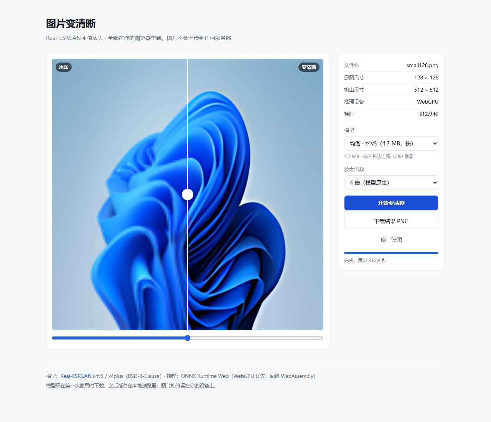

# 图片变清晰 · 浏览器端 Real-ESRGAN

把模糊、压缩过、分辨率低的图片放大 4 倍并补出细节。**全部计算在浏览器里完成**——图片不上传、不用装软件、不用注册，没有后端。

拖一张图进去，点一下按钮，下载 PNG。



## 在线使用

**https://mj-jia.github.io/ooo/**

首次打开需要下载模型（均衡 4.6 MB / 高质量 66 MB），之后缓存在浏览器里。

## 特性

- **纯前端推理**：ONNX Runtime Web，WebGPU 优先，不可用时回退 WebAssembly；同一份 `.onnx` 在两边都能跑
- **两个模型可切**：轻量 x4v3 与高质量 x4plus，共用一套分块管线
- **分块推理**：256×256 一块、每块多读 24 px 上下文、镜像反射补边、裁剪后再拼，大图不会爆内存且没有接缝
- **前后对比滑块**：左原图右结果，拖动对比
- **透明通道保留**：PNG 的 alpha 按同比例放大
- **模型本地缓存**：Cache Storage 缓存模型，二次打开不再下载
- **无构建步骤**：原生 ES module，三个文件，改一行刷新即可
- **模型侧代码在仓库里**：`src/models/` 是官方 SRVGGNetCompact 的等价实现与带恒等起点的改造版，
  权重可下载、结构可自检、参数量有断言（见 [docs/models.md](docs/models.md)）
- 附带 Python 参考实现与无头浏览器测试，浏览器输出与 Python 输出可逐像素对拍

## 目录

```
index.html              页面结构
app.js                  模型管理、分块推理、交互
style.css               样式
serve.py                本地服务器（带 COOP/COEP 头，启用多线程 WASM）
models/
  realesr-general-x4v3.onnx   均衡模型 4.6 MB（1.21 M 参数）
  upscaler-x4.onnx            高质量模型 66 MB（16.7 M 参数）
  manifest.json               校验和、输入输出、来源与许可
  README.md                   权重来源与换模型步骤
vendor/                 ONNX Runtime Web 1.31.1 预构建产物
src/                    模型侧（Python，页面不引用）
  models/srvgg_official.py    官方 SRVGGNetCompact 原版（34 层，1,213,296 参数）
  models/srvgg.py             本项目改造版（scale=1，33 层，1,150,339 参数）
docs/
  architecture.md       分块数学、内存模型、后端回退的实现细节
  development.md        本地运行、测试、对拍、部署、排查
  models.md             模型侧：两版结构对照、权重下载、结构自检
tools/
  reference_run.py      Python 参考实现（同一套分块逻辑）
  inspect_model.py      打印模型结构
  check_arch.py         模型结构自检（参数量 / 恒等起点 / 权重交叉载入）
  fetch_official_weights.py   官方权重下载
  e2e.mjs               无头浏览器端到端测试
  verify.mjs            校验模型/资源与 manifest 是否一致
requirements.txt        Python 依赖（页面本身不需要）
```

## 快速开始

### 网页版

```bash
npm run serve          # = python serve.py 8123
# 打开 http://127.0.0.1:8123/
```

必须经 HTTP 打开，`file://` 下 ES module 与 `fetch` 会被浏览器拦住。

`serve.py` 会带 `Cross-Origin-Opener-Policy` / `Cross-Origin-Embedder-Policy` 两个头，
浏览器因此启用 `SharedArrayBuffer`，WASM 后端可多线程，本地比线上快 3~4 倍。
GitHub Pages 设不了这两个头，线上固定单线程。

校验与测试：

```bash
npm run verify         # 纯 Node，校验 sha256 与资源引用
npm install && npm test   # 无头 Edge 跑一次真实推理，约 40 s
```

### 模型侧

```bash
pip install torch --index-url https://download.pytorch.org/whl/cpu   # 约 200 MB
python tools/fetch_official_weights.py     # 下官方 x4v3 + wdn-x4v3
python tools/check_arch.py                 # 结构自检，几秒跑完
```

`check_arch.py` 会打印两版结构的参数量、改造版的恒等起点误差（应为精确的 `0.0`），
以及官方权重载入改造版的命中率（96/98）。细节见 [docs/models.md](docs/models.md)。

## 怎么工作

1. 按 EXIF 方向解码；长边超过模型上限（均衡 1280 / 高质量 640）先等比缩小
2. 按 256×256 切块，每块向四周多读 24 像素上下文，越界部分镜像反射
3. 每块以 NCHW float32 送入模型，得到 4 倍输出，裁掉 24×4 = 96 像素边距
4. 拼回整图、量化到 8 bit；原图有 alpha 时按同比例放大保留
5. Canvas 显示、滑块对比、导出 PNG

细节（分块为什么是 24、内存上限怎么算、为什么优先 WebGPU）见 [docs/architecture.md](docs/architecture.md)。

## 模型怎么选

| 选项 | 模型 | 体积 | 参数 | 输入长边上限 | 适用 |
| --- | --- | --- | --- | --- | --- |
| 均衡（默认） | realesr-general-x4v3 | 4.6 MB | 1.21 M | 1280 | 日常用，几秒出图，手机也能跑 |
| 高质量 | Real-ESRGAN x4plus | 66 MB | 16.7 M | 640 | 追求细节，慢数倍，建议有独立显卡 |

注意上限不同导致的副作用：**大图选「高质量」时输出反而更小**（先缩到 640 再放大到 2560）。这是有意取舍，不是 bug。

## 实测数据

**Python + onnxruntime CPU（多线程），与网页同一套分块逻辑：**

| 模型 | 输入 | 分块 | 耗时 |
| --- | --- | --- | --- |
| x4v3 | 256 × 256 | 1 | 0.8–2.1 s |
| x4plus | 256 × 256 | 1 | 10.2 s |
| x4plus | 520 × 380 | 6 | 36.6 s |

**无头 Edge（无 GPU，WebGPU 走软件后端）：**

| 模型 | 输入 → 输出 | 端到端 |
| --- | --- | --- |
| x4v3 | 128 × 128 → 512 × 512 | 41.4 s |
| x4plus | 48 × 48 → 192 × 192 | 178.9 s |

这是**没有显卡**的最坏情况，真机开 WebGPU 快一个量级。

**线上首次访问（无缓存，国内直连 github.io）：**

| 场景 | 耗时 |
| --- | --- |
| 打开页面并跑完 128 × 128 → 512 | 312.9 s |

这五分钟里大头是下载（29 MB 的 WASM 运行时 + 模型，gzip 后约 11.6 MB，实测约 83 KB/s），不是算力。二次访问命中缓存后只剩推理时间。

**正确性：浏览器 vs Python 对拍**（同一张 128×128、同一个 x4v3 模型）

| 指标 | 数值 |
| --- | --- |
| 平均绝对误差 | 0.0 |
| 最大单通道差值 | 1 |
| 逐像素完全一致 | 99.99 % |
| PSNR | 92.94 dB |

分块接缝另做过数值检查：拼接处相邻列的梯度落在图像自身纹理波动范围内，无可见断层。

## 已知限制

- 输入长边超上限会先被缩小，不是「原图直接放大」；超过 800 px 的图用它意义不大
- 不做人脸专门修复（GFPGAN / CodeFormer 那类模型几百 MB，不适合放进纯前端页面）
- 只处理静态图：动图取第一帧，不支持 HEIC / TIFF / RAW / SVG
- 结果是模型**生成**的内容，原图没有的文字与纹理可能被“补”出来 —— 不要把车牌、证件号、病历这类图交给它
- GitHub Pages 无法设 `COOP` / `COEP`，WASM 后端只能单线程
- 输出固定 PNG，5120×5120 时文件可达二三十 MB
- `src/models/` 目前只有结构与权重加载，**不含训练与 ONNX 导出**；页面的 `models/*.onnx` 仍是第三方转换产物，与 `src/` 没有血缘关系

## 许可

- 本项目代码：MIT，见 [LICENSE](LICENSE)
- `src/models/srvgg_official.py`：Real-ESRGAN（Xintao Wang 等），BSD-3-Clause，逐层等价的改写
- 模型权重：Real-ESRGAN，BSD-3-Clause，来源与转换见 [models/README.md](models/README.md)
- ONNX Runtime Web 1.31.1：MIT

商用前请自行核对上游许可原文。

## 文档

- [docs/architecture.md](docs/architecture.md) — 实现细节与设计取舍
- [docs/development.md](docs/development.md) — 本地运行、测试、对拍、部署
- [docs/models.md](docs/models.md) — 模型侧：两版结构对照、权重、自检
- [models/README.md](models/README.md) — 权重来源、许可、换模型步骤
- [vendor/README.md](vendor/README.md) — 运行时文件与版本更新
